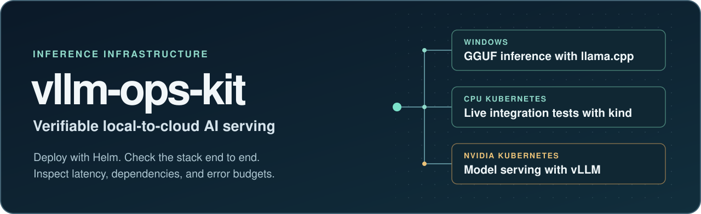

# vllm-ops-kit

[Українська](README.uk.md) · [Measured results](loadtest/results/README.md) · [Architecture](docs/ARCHITECTURE.md) · [Cloud deployment](docs/CLOUD.md)

Run a local GGUF through an OpenAI-compatible API on Windows, verify the full stack on a disposable Kubernetes cluster, or serve a Safetensors model with vLLM on NVIDIA. The kit connects [Verstak Agent](https://github.com/Galactic717/verstak-agent) and [Verifine SLM](https://github.com/Galactic717/verifine-slm) with PostgreSQL, Redis, and Celery. CI checks the deployment, application traffic, network policies, and metrics together.

## Measured on a clean kind cluster

| Helm install and readiness | 3× spike throughput | Chat p95 at spike | HTTP errors |
|---:|---:|---:|---:|
| 20.48 s | 30.05 req/s | 4.26 ms | 0% |

The CPU fixture run on 24 November 2026 measured HTTP latency through Traefik and Verifine. The Helm timer covers the application release after cluster setup and image import. In a separate Windows run, Gemma 4 E4B generated a response through llama.cpp and Verifine in 497.4 ms. [k6 summaries, HPA samples, and Windows results](loadtest/results/README.md)

## Choose a deployment

| Profile | Use it to verify | Start here |
|---|---|---|
| Windows + llama.cpp | Real local generation, SSE, token usage, and gateway metrics | [Windows smoke test](#windows-with-llamacpp) |
| kind + CPU fixture | Ingress, OAuth, Celery, PostgreSQL, Redis, Prometheus, Grafana, and k6 | [Kubernetes quickstart](#kubernetes-quickstart) |
| Ubuntu VM + CPU fixture | Terraform provisioning, Ansible, systemd, TLS, and Node Exporter | [Ubuntu deployment](docs/CLOUD.md#ubuntu-cpu-fixture) |
| NVIDIA + vLLM | GPU model serving from a PVC, TTFT, TPOT, and KV cache utilization | [GPU deployment](docs/CLOUD.md#nvidia-kubernetes) |

## Kubernetes quickstart

Use Git, Python 3.10+, and Docker Engine 28+ with Linux amd64 containers. Allocate at least 4 CPUs and 8 GiB of RAM to Docker.

~~~bash
git clone https://github.com/Galactic717/vllm-ops-kit.git
cd vllm-ops-kit
~~~

On Ubuntu, install the pinned CLI tools and start the lab.

~~~bash
bash scripts/ci_tools.sh .tools/bin
export PATH="$PWD/.tools/bin:$PATH"
python3 scripts/images.py --fetch
python3 scripts/kind_lab.py
~~~

On Windows with Docker Desktop, run these commands in PowerShell from the cloned project.

~~~powershell
pwsh -File scripts/install-windows-tools.ps1
$env:PATH = "$(Join-Path $PWD '.tools/bin');$env:PATH"
python scripts/images.py --fetch
python scripts/kind_lab.py
~~~

The lab binds Ingress to **127.0.0.1:18080** and uses the dedicated kubeconfig `.kubeconfig-kind`. The runner creates application credentials and writes k6 summaries and HPA samples to `loadtest/results/latest/`.

~~~sh
kubectl --kubeconfig .kubeconfig-kind -n monitoring port-forward svc/kps-grafana 13000:80
~~~

Open Grafana at http://127.0.0.1:13000. Sign in as `admin` with the `admin-password` key from the `kps-grafana` Secret in the `monitoring` namespace. The [architecture guide](docs/ARCHITECTURE.md#signals) lists the metrics behind the dashboards.

Use `python scripts/kind_lab.py --verify-only` to rerun checks against the existing lab. Add `--profiles soak --base-rate 5` for a ten-minute run. Remove the lab with `kind delete cluster --name vllm-ops-kit --kubeconfig .kubeconfig-kind`.

## Windows with llama.cpp

Start Docker Desktop and your existing llama.cpp launcher. Pass its port to the smoke test. The script reads the serving model from `/v1/models` and starts a temporary Verifine container.

~~~powershell
python scripts/images.py --fetch
pwsh -File scripts/local.ps1 -Port 9941
~~~

Use `LLAMA_API_KEY` in the current PowerShell environment if the backend requires a key. On a workspace with sibling checkouts of Verstak and Verifine, `python scripts/images.py` builds directly from those copies.

To run a temporary CPU server from an explicit GGUF, pick an unused port and supply the model path.

~~~powershell
$model = Get-ChildItem "$env:LOCALAPPDATA/Programs/llama.cpp/models" -Recurse -Filter 'gemma-4-E4B-it-UD-Q8_K_XL.gguf' | Select-Object -First 1
pwsh -File scripts/local.ps1 -Port 18091 -ModelPath $model.FullName
~~~

## Operate the stack

- [Architecture and rollout strategy](docs/ARCHITECTURE.md)
- [AWS, GCP, remote state, and GitHub OIDC](docs/CLOUD.md)
- Runbooks for [Redis unavailable](docs/runbooks/redis-down.md), [PostgreSQL locks](docs/runbooks/db-lock.md), [worker OOM](docs/runbooks/oomkilled.md), [disk pressure](docs/runbooks/disk-pressure.md), and [upstream HTTP 429](docs/runbooks/llm-429.md)

The Ubuntu play has passed syntax validation, and the GPU Helm profile has passed Kubernetes server dry run. AWS/GCP provisioning and live vLLM GPU inference still require a target environment. See the [verification report](loadtest/results/README.md) for scanner scope and open findings.
