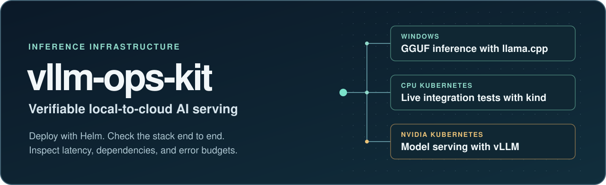

# vllm-ops-kit

[English](README.md) · [Вимірювання](loadtest/results/README.md) · [Архітектура](docs/ARCHITECTURE.md) · [Хмарне розгортання](docs/CLOUD.md)

Запускайте локальні GGUF-моделі через llama.cpp у Windows, перевіряйте повний стек у тимчасовому kind-кластері або розгортайте vLLM із моделлю Safetensors на NVIDIA GPU. Проєкт з’єднує [Verstak Agent](https://github.com/Galactic717/verstak-agent) і [Verifine SLM](https://github.com/Galactic717/verifine-slm) з PostgreSQL, Redis і Celery. CI разом перевіряє розгортання, HTTP-запити, мережеву ізоляцію та метрики.

## Результати на чистому kind-кластері

| Helm до готовності | Пропускна здатність на піку 3× | p95 чату | HTTP-помилки |
|---:|---:|---:|---:|
| 20,48 с | 30,05 запиту/с | 4,26 мс | 0% |

Вимірювання з CPU-фікстурою від 24 листопада 2026 року охоплюють HTTP-запити через Traefik і Verifine. Час Helm відраховано після підготовки кластера й імпорту образів. В окремому тесті Windows модель Gemma 4 E4B відповіла через llama.cpp і Verifine за 497,4 мс. [Сирі звіти k6, дані HPA та результати Windows](loadtest/results/README.md)

## Профілі розгортання

| Профіль | Що перевіряє | Інструкція |
|---|---|---|
| Windows + llama.cpp | Реальна локальна генерація, SSE, лічильники токенів і метрики шлюзу | [Перевірка Windows](#локальна-перевірка-у-windows) |
| kind + CPU-фікстура | Ingress, OAuth, Celery, PostgreSQL, Redis, Prometheus, Grafana та k6 | [Швидкий запуск Kubernetes](#швидкий-запуск-kubernetes) |
| Ubuntu VM + CPU-фікстура | Terraform, Ansible, systemd, TLS і Node Exporter | [Розгортання Ubuntu](docs/CLOUD.md#ubuntu-cpu-fixture) |
| NVIDIA + vLLM | Модель із PVC, TTFT, TPOT і використання KV-кешу | [Розгортання GPU](docs/CLOUD.md#nvidia-kubernetes) |

## Швидкий запуск Kubernetes

Потрібні Git, Python 3.10+ і Docker Engine 28+ з Linux-контейнерами amd64. Виділіть Docker щонайменше 4 CPU та 8 ГіБ пам’яті.

~~~bash
git clone https://github.com/Galactic717/vllm-ops-kit.git
cd vllm-ops-kit
~~~

У Windows запустіть Docker Desktop і виконайте в PowerShell.

~~~powershell
pwsh -File scripts/install-windows-tools.ps1
$env:PATH = "$(Join-Path $PWD '.tools/bin');$env:PATH"
python scripts/images.py --fetch
python scripts/kind_lab.py
~~~

В Ubuntu встановіть зафіксовані версії інструментів і запустіть стенд.

~~~bash
bash scripts/ci_tools.sh .tools/bin
export PATH="$PWD/.tools/bin:$PATH"
python3 scripts/images.py --fetch
python3 scripts/kind_lab.py
~~~

Ingress слухає **127.0.0.1:18080**. Стенд використовує окремий `.kubeconfig-kind` і записує звіти до `loadtest/results/latest/`. Команда `python scripts/kind_lab.py --verify-only` повторює перевірку вже запущеного стенду. Щоб видалити стенд, виконайте `kind delete cluster --name vllm-ops-kit --kubeconfig .kubeconfig-kind`.

## Локальна перевірка у Windows

Запустіть свій лаунчер llama.cpp і Docker Desktop. Укажіть порт лаунчера. Скрипт визначить ідентифікатор моделі й підніме тимчасовий шлюз Verifine.

~~~powershell
python scripts/images.py --fetch
pwsh -File scripts/local.ps1 -Port 9941
~~~

Якщо сервер вимагає ключ, передайте його через змінну середовища `LLAMA_API_KEY`. Якщо у вас є сусідні репозиторії Verstak і Verifine, команда `python scripts/images.py` збере образи з локальних копій.

Щоб запустити тимчасовий CPU-сервер з конкретною моделлю, передайте її GGUF-файл і вільний порт.

~~~powershell
$model = Get-ChildItem "$env:LOCALAPPDATA/Programs/llama.cpp/models" -Recurse -Filter 'gemma-4-E4B-it-UD-Q8_K_XL.gguf' | Select-Object -First 1
pwsh -File scripts/local.ps1 -Port 18091 -ModelPath $model.FullName
~~~

## Експлуатація

- [Архітектура, мережа, секрети, метрики й оновлення](docs/ARCHITECTURE.md)
- [AWS, GCP, віддалений стан Terraform і GitHub OIDC](docs/CLOUD.md)
- Інструкції для інцидентів [Redis](docs/runbooks/redis-down.md), [блокування PostgreSQL](docs/runbooks/db-lock.md), [OOMKilled](docs/runbooks/oomkilled.md), [нестачі місця на диску](docs/runbooks/disk-pressure.md) і [HTTP 429 від LLM](docs/runbooks/llm-429.md)

Ansible пройшов перевірку синтаксису, а GPU-чарт пройшов серверну перевірку Kubernetes. Розгортання в AWS/GCP і роботу vLLM на GPU ще потрібно перевірити в цільовому середовищі. [Обсяг перевірок і знахідки сканерів](loadtest/results/README.md)
